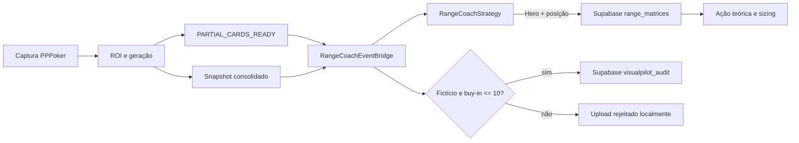

# Integração com Range Coach Pro

O módulo `visualpilot/agent/connector.py` acessa o Supabase por PostgREST sobre HTTPS. A chave é lida de `nvt_config.ini` ou de uma variável de ambiente referenciada pelo arquivo. `nvt_config.ini` está ignorado pelo Git; `nvt_config.example.ini` documenta os campos esperados.

O conector não executa ações. Uma consulta só ocorre quando existem duas cartas válidas e uma posição conhecida. O VisualPilot ainda não reconhece posição; portanto, esse dado precisa ser acrescentado ao estado observado ou fornecido pelo integrador antes da consulta.

`RangeCoachEventBridge` é injetável em `PerceptionSession`. Ele recebe `PARTIAL_CARDS_READY` e `SNAPSHOT_CONSOLIDATED`, faz as chamadas em um pool separado e devolve `range_coach_result` ao painel. O provedor de contexto deve informar posição e torneio; sem isso, a consulta permanece pendente e a auditoria é rejeitada localmente.

O upload de auditoria exige `fictional=true` e buy-in entre zero e o limite configurado. Nomes de tabelas e da coluna de mão são configuráveis porque o esquema real do projeto Supabase ainda não foi fornecido.

`visualpilot/viz/app.py` oferece `render_cloud_diagnostic()` para um host Streamlit e não adiciona Streamlit às dependências básicas. O aplicativo atual do VisualPilot permanece em Tk.
